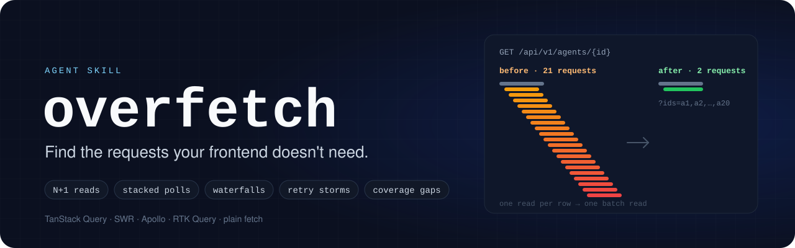

<p align="center">
  
</p>

<p align="center">
  <a href="LICENSE"></a>
  
  <a href="benchmarks/README.md"></a>
</p>

# overfetch

An agent skill that audits how a frontend app talks to its backend and tells you what to fix, in order.

It finds the ways a web app makes more requests than its screens need: one read per row, the same read twice, poll timers that stack, caches that never count as fresh, invalidations that reload the page, requests that run one after another when they could run together, page sizes that fetch everything, and retries that hammer a 404. It ranks them by how the request count grows, backs each with a `file:line` or a capture, names the fix, and says which parts of the app it exercised and which it only read.

Works with TanStack Query (React Query), SWR, Apollo Client, RTK Query, and apps that call `fetch` by hand.

## What you get

A markdown report:

- **Scope and evidence**: tree, commit, library, cache defaults, captures.
- **Coverage**: every route, lazy chunk, gated data site and endpoint, and which were exercised in a capture versus read in code only.
- **Findings**, ranked P0 to P3, each with evidence, cause, fix pattern, measured or formula-based delta, and effort.
- **Non-findings**: what was checked and ruled out, so nobody re-investigates.
- **Open decisions** and **backend asks**: the parts that are not a client patch.
- **Contradictions** with existing docs, and **limits** of the audit.

Excerpt from the benchmark's static audit of the test fixture (R is the list's row count):

| # | Severity | Finding | Growth | Measured | Fix pattern | Effort |
| --- | --- | --- | --- | --- | --- | --- |
| 1 | P0 | Every keystroke in the search box invalidates and refetches every mounted query | keystrokes × mounted queries | unmeasured; R + 3 → 0 per keystroke (53 → 0 at R = 50) | Narrow invalidation (here: delete it) | 0.5 h |
| 2 | P0 | `AgentRow` reads the whole agent, one request per row, to print its name | rows | unmeasured; R → 0 per list mount | Batch names projection (or pass the name from the list) | 1.5 h |
| 3 | P0 | `/v1/status` is polled every 5 s by a `setInterval` that is never cleared | mounts × time | unmeasured; 12k reads/min after k mounts | Single poller via a query | 1.5 h |
| 6 | P2 | Billing summary polls every 60 s forever, defined in a shared hook | time | unmeasured; 60/h per tab (one fetch per interval, not one per caller) | Single poller | 1 h |
| 7 | P2 | Run history polls every 10 s with no stop (latent: the dialog cannot open today) | time while open | unmeasured; 6/min while open | Data-driven interval | 1 h |

## Benchmarks

Each eval case runs twice: once by an agent told to use the skill, once by an agent with no skill. A separate grader agent checks both reports against fixed assertions and quotes its evidence.

| Case | With overfetch | Without |
| --- | --- | --- |
| App audit: planted issues, file routes, a lazily loaded flag-gated dialog | 11 / 11 | 8 / 11 |
| HAR analysis: capture only, no source tree | 10 / 11 | 6 / 11 |
| Clean app: must not invent problems | 7 / 7 | 6 / 7 |
| **All assertions** | **28 / 29 (97%)** | **20 / 29 (69%)** |
| Mean tokens per run | 190k | 147k |
| Mean wall time per run | 425 s | 284 s |

Both configurations find the obvious patterns. The skill wins on what the baseline leaves out: a coverage section that names the routes, lazy chunks and gated screens it only read, correct library semantics (same-key TanStack poll timers re-sync and share a fetch; the baseline claimed they stack), causes from a capture labelled as inferences, and an explicit list of what was ruled out.

One run per configuration per case, synthetic fixtures, LLM grading. Method, the earlier iteration, and every assertion with its evidence: [`benchmarks/`](benchmarks/README.md).

## Install

The skill is a folder. Put it where your agent looks for skills:

- **Claude Code, personal**: `~/.claude/skills/overfetch/`
- **Claude Code, per project**: `<repo>/.claude/skills/overfetch/`
- **Codex**: `<repo>/.codex/skills/overfetch/` (or symlink the Claude folder)
- Any other agent that reads `SKILL.md`: point it at the folder.

```bash
git clone https://github.com/alii13/overfetch ~/.claude/skills/overfetch
```

The scripts need Python 3.9+ and nothing else. `scripts/capture.mjs` needs Node 18+ and Playwright installed in the project you are capturing.

## Use

In a Claude Code session inside the app's repo:

> Audit the network requests in this app and tell me what to fix.

> The backend team says our dashboard hammers them. Do a request audit of `apps/web`.

> Here's a HAR from the home page (`capture.har`). What's wrong with our request pattern?

The agent maps the app's surface, runs the static scan, reads the code behind each candidate, captures the running app when it can (or analyses the HAR you give it), and writes the report. Expect 15 to 30 minutes for a static audit of a mid-sized app, more with captures.

You can also run the tools without an agent:

```bash
# the whole surface: routes, lazy chunks, gated reads, endpoints; add --har to mark what a capture exercised
python3 scripts/coverage_map.py path/to/app --format md --out coverage.md

# candidates from the source tree
python3 scripts/static_scan.py path/to/app --format md --out scan.md

# facts from a capture (HAR from DevTools, Playwright, a proxy, or plain JSON rows)
python3 scripts/har_analyze.py capture.har --format md --out capture.md

# record a HAR of a journey (needs Playwright in the project)
node scripts/capture.mjs http://localhost:5173/ capture.har --journey journey.json --idle 180000
```

On a 2,156-file React app the coverage map takes about 4 seconds and the scan about 11.

## What it checks

| Pattern | Detected by | Severity |
| --- | --- | --- |
| Query hook inside a row component (N+1) | scan + capture bursts | P0 |
| Poll interval in a hook several components call (timers stack in SWR and Apollo; re-sync in TanStack, so it is cadence ownership) | scan + capture `timers: k` | P0 to P2 by library |
| Unconditional poll; `setInterval` driving reads; uncleared timers | scan + capture | P0 to P2 |
| No default `staleTime`; `staleTime: 0`; `"always"` refetch modes | scan + capture duplicates | P1 |
| Blanket invalidation, especially from input handlers | scan | P0 / P2 |
| `useEffect` fetching by hand; HTTP calls in the view layer | scan | P1 / P3 |
| Independent awaits in series; suspense waterfalls | scan + capture chains | P2 |
| Page sizes ≥ 500; loops over every page; pagination overshoot | scan + capture | P2 |
| Whole object fetched for a label | scan | P2 |
| `Promise.all` fan-out with no ceiling | scan + capture peak in flight | P1 |
| Keys that differ only by spelling | scan | P2 |
| Repeated identical 4xx (retry waste) | capture | P1 |
| Routes, lazy chunks and gated screens no capture exercised | coverage map | reported, not ranked |
| Hover prefetch, persisted caches, custom focus listeners | scan, recorded as info | info |

The full list, with how each is verified and fixed, is in [`references/catalog.md`](references/catalog.md). Library semantics the audit relies on (timer re-sync, dedup windows, focus throttles, retry defaults) are in [`references/library-facts.md`](references/library-facts.md), each with the version it was checked against.

## How it works

1. **Map the surface**: `coverage_map.py` lists every route, dynamic-import boundary, flag/platform/permission-gated data module and endpoint path, so the audit has a denominator and the captures have a plan.
2. **Scan**: `static_scan.py` walks the tree, builds an import graph, finds components and data hooks, and emits candidates with a confidence per detector.
3. **Verify**: the agent reads the code behind every candidate it keeps. A regex hit is never reported as a finding on its own.
4. **Cross-cutting reads** the scanner cannot do: key canonicality, dependent keys, freshness per data family, poll ownership, focus semantics, pagination contracts, retry policy, persistence, mutation invalidation.
5. **Capture**: journeys chosen from the map and run across a state matrix (empty, populated, error, slow, offline, idle, hidden, flags, roles, cold and warm cache). The HAR is analysed for bursts, stacked timers, duplicates (POST bodies hashed), serial chains, repeated errors and large responses, and the map is rerun to show what the captures exercised.
6. **Reconcile and rank**: measured counts win over assumptions; the code explains the cause; findings are ranked by growth class; non-findings and limits are written down.

## Limits

- The scanner reads text, not types. It cannot see through dynamic component maps, string-built keys, or hooks composed more than one level deep. Confidence tells you how often a detector is right, not how bad the issue is.
- The import graph resolves relative paths and common aliases (`@/`, `~/`, `src/`); exotic alias maps fall back to basename matching.
- A capture from fixture data proves a shape, not production volume.
- Module-level capture coverage is exact against a dev server; against a production build it relies on chunk names, and code-split chunks named by id cannot be matched.
- Route detection covers file-based routers and the path literals of code-defined ones; nested relative paths in code-defined routers are not joined.
- The scanner picks poll severities from the library it detects in `package.json`; RTK Query's per-entry polling and Apollo's normalized cache are covered in the library facts, not in the scanner's rules.

## Tests

```bash
python3 -m unittest discover -s scripts/tests -v
```

Forty-four tests cover the three Python tools against a fixture app with planted issues (file routes, a lazily loaded flag-gated dialog, a shared poll, an uncleared interval) and a synthetic HAR. Add a fixture file and a test for any new detector.

## Evals

`evals/` holds the three benchmark cases in the layout `claude plugin eval` reads. Run them with:

```bash
claude plugin eval . --allow-tools Read,Glob,Grep,Bash,Write --scaffold
```

## Contributing

- One detector per pull request, with a fixture that triggers it and a clean case that does not.
- Every fact in `references/library-facts.md` names the library version it was checked against.
- Keep the scripts on the standard library.
- Severity changes need a sentence on the growth class that justifies them.
- A change to `SKILL.md` or the references reruns the evals; post the before and after in the pull request.

## License

MIT. See [LICENSE](LICENSE).
